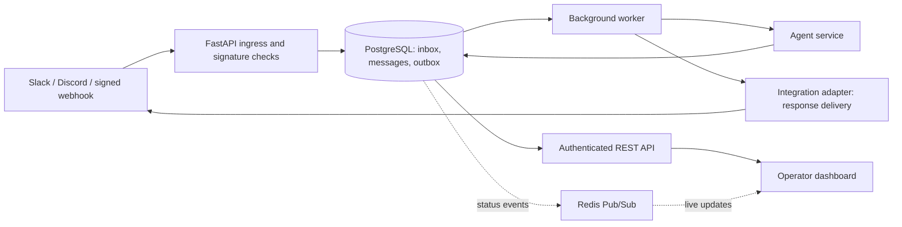

# AI Agent Integration Hub: Final Version Plan

## Product goal

Build a dependable event gateway that lets external services send events to an AI agent and receive its response. The project should demonstrate provider integrations, secure event handling, reliable asynchronous processing, and operational quality.

This gives the project a clear portfolio role alongside Grinta: Grinta demonstrates agents invoking tools; this hub demonstrates the infrastructure for receiving events from real services and responding through them.

The final version is a polished, reproducible portfolio system. Avoid calling it production-ready unless its deployment, security, and operational controls have been independently reviewed.

### Baseline update

The baseline milestone is in progress: the root ignore rules no longer hide frontend source or `package-lock.json`; generated coverage artifacts are ignored; dependency pins install in a fresh virtual environment with a clean `pip check`; the Python suite now passes 60 tests; and the Next.js production build succeeds. The test run reports deprecation warnings from Pydantic configuration and naive UTC timestamps; those should be cleaned up before release.

The first durable lifecycle slice is now in the working tree. Signed webhook requests that normalize to messages are saved with an inbox deduplication record and a `process_message` outbox record in the same transaction, then acknowledged with HTTP 202. The worker claims eligible work with a lease, processes messages, queues response delivery, retries with bounded backoff, and marks exhausted jobs dead. Tests cover acceptance, duplicate Slack event handling, process/delivery, retry, and dead-letter behavior. This is an initial implementation milestone, not completion of the lifecycle scope below.

The initial migration has been applied successfully to a fresh SQLite database; the expected inbox/outbox tables, indexes, uniqueness constraint, and Alembic revision table were inspected. The API event listing was exercised against that database. Operator authentication uses a PBKDF2 password hash, Redis backed failed-login throttling, a short-lived signed HttpOnly cookie, CSRF validation for unsafe requests, and configured CORS origins. Active session IDs are stored in Redis; HTTP and WebSocket requests check the shared record, and logout deletes it. The dashboard uses the cookie and the socket validates both session and Origin. A new opt-in pytest integration test starts two API processes and verifies shared Redis throttling and session revocation; CI runs it against the Redis service. It passed locally against a temporary Redis 7 instance. The normal backend suite passes 60 tests with this integration test skipped unless explicitly enabled, and the frontend production build succeeds. All temporary servers and files were removed afterward.

## Product scope

### Supported in the featured release

- **Slack:** signed event requests, URL verification, message normalization, and replies.
- **Discord:** signed Interactions Endpoint requests, PING handling, supported interaction normalization, and replies.
- **Generic webhook:** signed inbound events and signed outbound responses, with a documented canonical payload and signature format.
- **Agent API:** authenticated direct requests for demos and service-to-service callers.
- **Operator dashboard:** event history, processing and delivery status, and basic service health.

Email can remain an outbound adapter or be added later through a defined inbound provider. Do not present the current generic email payload parser as a secured email integration. Defer an integration marketplace, arbitrary connector builder, multi-agent orchestration, and broad multi-tenant management; they add scope without strengthening the core demonstration.

## Final system behavior

For an external event, the service verifies the provider signature against the original request bytes, checks freshness and required fields, and persists the event with a deduplication key. It acknowledges the provider promptly after durable acceptance. A worker processes the event, records the agent result, and delivers the response through the same integration. Failed work is retried with bounded backoff and eventually appears in a dead-letter state that an operator can inspect.

For direct API chat, callers receive a documented response and a persisted history record. The dashboard reads real API state; it does not show hard-coded integration health or calculate operational analytics from only the latest 100 messages.

## Target architecture

PostgreSQL is the durable source of truth. Use inbox/outbox records to avoid losing work between database commits and queue publication. Redis may carry transient live updates; Redis Pub/Sub must not be the only record of an event or job. Workers must be safe to restart and process a job more than once.

## Repository audit: current state

| Area | What exists now | Gap to final version |
|---|---|---|
| API and persistence | FastAPI routes, SQLAlchemy message/integration models, SQLite default, inbox/outbox models, provider event uniqueness, and an initial Alembic migration | Startup `create_all` remains for local development; migrations cover the new event tables only; event rows retain normalized linkage rather than a versioned provider-neutral payload contract |
| Processing | Direct API chat remains inline; inbound webhook work is persisted and handled by a lease-based worker with retry/dead-letter states; authenticated `GET /api/v1/events` exposes attempt status | Worker lease is not renewed for long tasks; external delivery is at-least-once and lacks provider-specific idempotency |
| Queue/event services | Redis list enqueue/dequeue helpers and Pub/Sub | Queue helpers are not used by the ingress flow; list queue has no acknowledgment or retry semantics |
| Connectors | Slack, Discord, email, generic webhook adapters | Discord parser is not aligned to Interaction payloads; email ingress is generic parsing; delivery failures are often returned but ignored |
| Request security | PBKDF2 hashed single-operator credential; Redis atomic login throttle (five failures per 15 minutes); signed short-lived HttpOnly session with Redis-backed active-session record; CSRF checks; configurable CORS origins | No multi-operator account lifecycle; email path is not provider-authenticated; outbound webhook URL needs SSRF controls; no body-size or general API rate-limit enforcement |
| WebSocket | Browser WebSocket authenticates with the signed operator session, checks the shared Redis session record, and validates `Origin` | Uses single-operator session; no per-role scope |
| Agent/model | LangChain runnable with Google GenAI wrapper | `response_metadata` labels Gemini output as `gpt-4`; fallback errors can be returned as agent replies; debug prints remain in model utility |
| Dashboard | Next.js screens for chat, messages, integrations, analytics; operator login uses cookie sessions; legacy API key storage is cleared; WebSocket uses the operator session | Integration states are hard-coded; analytics are a latest-100-message calculation; API base settings need more integration testing |
| Tests and CI | Python suite passes 60 tests; opt-in two-process Redis auth integration test runs in CI and passed locally; clean SQLite migration and authenticated event listing smoke check pass; Next.js production build succeeds | Tests are mostly mocked and do not prove real provider-to-worker-to-reply behavior; concurrent outbox-worker recovery has not been verified; add frontend lint/type checks if configured |
| Documentation and repository | README, architecture, demo guides, security policy; frontend source and lockfile are now visible to Git after the baseline ignore fix | Architecture and README overstate current guarantees; `SECURITY.md` has a placeholder reporting email; frontend files are still untracked and must be reviewed before they are added to a commit |

The audit reflects the working tree reviewed for this plan. The repository already contains unrelated uncommitted changes; review those before treating a future diff as a release-ready branch.

## Delivery plan

### 1. Establish a coherent, reviewable baseline

**Outcome:** a cleanly installable project whose checked-in source matches the documented app.

- Keep the aligned dependency pins in `requirements.txt`; install from that file without a second unpinned `httpx` install in CI.
- Fix the root ignore rule so the frontend's `lib` source is tracked while Python build artifacts remain ignored.
- Separate secrets and generated artifacts from source; confirm `.env`, coverage output, and local build files are not committed.
- Replace the placeholder security contact and stale architecture claims.
- Make Python CI deterministic and add frontend install, lint/type-check, and production-build jobs.

**Done when:** a clean checkout installs from documented commands, CI runs both backend and frontend checks, and all required source files are tracked.

### 2. Define the event contract and durable lifecycle

**Outcome:** every accepted event has one traceable, recoverable lifecycle.

- Introduce a provider-neutral event schema containing provider, provider event ID, event type, source identity, received time, normalized content, and limited safe metadata.
- Persist verified inbound events and their processing work atomically. Add uniqueness constraints for provider event IDs and explicit idempotency behavior.
- Add migrations for schema changes; use `alembic upgrade head` for deployed databases and phase out reliance on `create_all` as an upgrade mechanism.
- Model states such as accepted, queued, processing, completed, delivery-pending, delivered, retrying, and dead-lettered. Record attempt count and timestamps; the initial authenticated event status endpoint now exposes outbox state and sanitized error types.
- Make ingress return quickly after durable acceptance. Run agent processing and response delivery in restart-safe workers, with bounded retry/backoff and operator-visible terminal failures.
- Preserve raw payloads only where needed for debugging, with size limits, redaction, and a retention policy.

**Done when:** replaying an event does not create duplicate work, a worker restart does not lose accepted events, and processing or delivery failures can be retried and inspected.

### 3. Finish and narrow the connector set

**Outcome:** three integrations work end to end and have explicit support boundaries.

- Keep provider verification at ingress over raw request bytes; test valid, tampered, missing, and stale signatures.
- Complete Slack event parsing, bot/event filtering, response threading, and delivery error handling.
- Implement the Discord Interactions payload contract, PING response, supported command/message normalization, and response format. Do not treat arbitrary Discord message-shaped JSON as a real interaction.
- Specify generic webhook canonicalization, HMAC header format, timestamp/replay behavior, and example client code. A generic signature must cover the transmitted representation unambiguously.
- Standardize the adapter interface around verification, normalization, delivery, and health/config validation. Keep provider-specific rules inside each adapter.
- Defer inbound email until it has a real signed provider/IMAP ingestion design. Keep unsupported integrations visibly unsupported.

**Done when:** each featured connector has one documented end-to-end demo, provider contract tests, and honest status in the UI and README.

### 4. Complete the security boundary

**Outcome:** public ingress, operator API, browser UI, and outbound calls have distinct controls.

- Replace the single-operator environment credential with an account lifecycle and role model. Keep provider credentials server-side; never store an administrative API key or WebSocket service token in public frontend storage.
- The dashboard now uses a PBKDF2 password hash, short-lived signed session cookie, and CSRF checks. Review session rotation, deployment cookie settings, and credential recovery before release.
- HTTP and WebSocket now check shared Redis session state, and logout revokes the session across workers. Keep Redis availability and recovery behavior in deployment checks.
- Restrict CORS to configured origins; do not combine wildcard origins with credentials.
- Enforce request size limits, payload validation, rate limits, signature freshness, and useful 401/400 responses without exposing stack traces or secrets.
- Prevent SSRF in outbound webhooks: use configured destinations, reject local/private/link-local targets, validate redirects, and handle DNS resolution safely.
- Remove credentials from database JSON or encrypt them with a documented key-management strategy. Avoid logging message bodies and raw provider payloads by default.

**Done when:** security tests cover unauthenticated access, invalid/replayed signatures, origin policy, payload limits, outbound URL restrictions, secret redaction, and safe error responses.

### 5. Make the dashboard reflect the real service

**Outcome:** an operator can understand and troubleshoot actual integration activity.

- Replace hard-coded connector cards with API-backed configured/healthy/degraded states.
- Show event ID, provider, received time, processing state, retries, and delivery result. Protect message content and credentials according to role.
- Use explicit API pagination and filters rather than calculating statistics from a fixed 100-message sample.
- Make chat responses appear once. Today REST returns the response while Redis/WebSocket may also publish it, so the UI needs a single source of truth or correlation-based deduplication.
- Align dashboard connection settings, WebSocket authentication, API base URL, and deployment origins.

**Done when:** the dashboard reports actual backend state and does not claim an integration is connected unless the backend confirms it.

### 6. Add operations, reproducibility, and release evidence

**Outcome:** reviewers can run the system and see its reliability boundaries.

- Provide a local Compose environment for the API, worker, PostgreSQL, and Redis, with health checks and safe sample configuration.
- Add structured logs and correlation IDs across ingress, worker, model call, and delivery. Record latency, retry counts, and model usage without logging secrets or unnecessary personal data.
- Provide readiness/liveness checks, graceful worker shutdown, and clear behavior when PostgreSQL, Redis, or the model provider is unavailable.
- Add end-to-end tests using local fakes or service containers, plus a documented failure/retry demonstration. Keep unit tests deterministic and independent of a live Gemini key.
- Record a reproducible benchmark for event acknowledgment latency, processing time, and delivery outcomes under a stated workload.
- Update README, architecture, setup, security, and demo material from the actual implementation; remove “production-ready” claims unless the release meets an explicit operational standard.

**Done when:** a new reviewer can launch the demo, configure one provider, send an event, observe processing and reply, and reproduce a failure/retry case from the documentation.

## Final acceptance criteria

- Slack, Discord, and generic signed webhooks pass end-to-end tests, including provider verification and response delivery.
- Webhook acknowledgment is decoupled from model latency and follows durable acceptance.
- Duplicate delivery is idempotent; retries and dead-lettering are visible and recoverable.
- The browser uses a safe user-session flow and does not contain backend secrets.
- Database migrations, CI, local deployment, and frontend builds work from a clean checkout.
- The UI, README, architecture diagram, and demo accurately describe shipped behavior.
- CI is green, including tests for security failures and worker recovery; a short demo and measured reliability report are included.

## Recommended implementation order

Treat these as release milestones rather than a checklist of tiny tasks: **baseline and repository hygiene → durable event lifecycle → connector contracts → security boundary → dashboard integration → deployment and evidence**. The event lifecycle and security boundary are the core engineering work; visual polish comes after those behaviors are stable.
